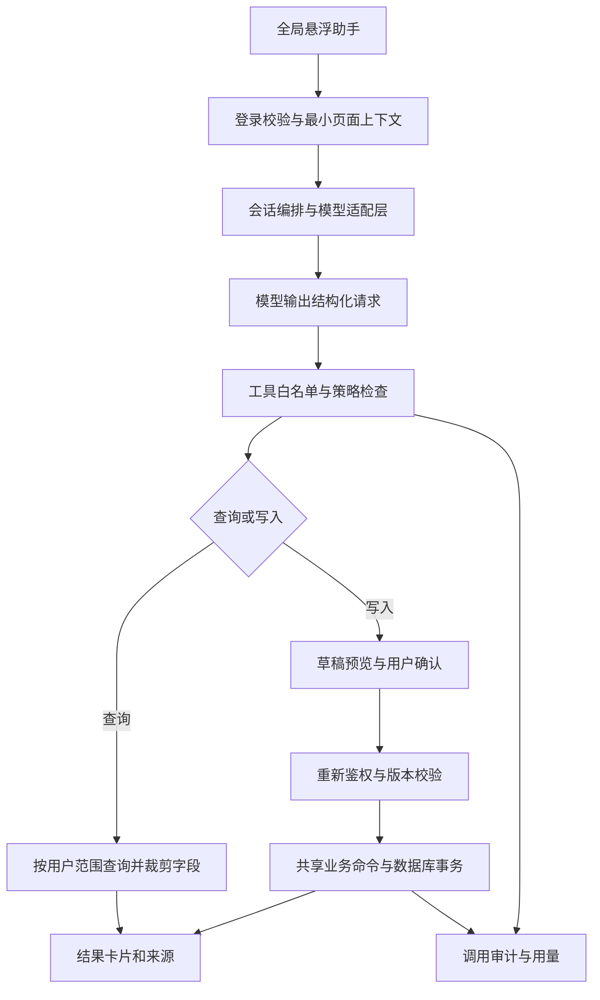

# 唯哆鲜运营管理台 AI 运营助手设计方案

版本：1.0｜更新日期：2026-10-21｜状态：设计基线，首版实施情况见[实施记录](./ai_operations_assistant_implementation.md)

适用范围：现有 `admin-web` 运营台与 `backend` 服务。本文覆盖目标交互、业务流程、权限、技术架构、实施顺序和验收要求；实际已交付能力、启用条件和当前边界以实施记录为准。

## 1. 产品定位与交付范围

将助手定位为管理人员随时可用的运营工作入口：理解文字和图片，查询授权数据，整理事务，生成可检查的操作草稿，并在确认后执行允许的业务动作。

总体形态为“全局悬浮助手 + 左侧单个配置入口 + 后端受控业务工具”。正常使用始终在悬浮窗内完成，配置、角色策略、模型连接和使用记录集中在一个配置页面。

第一版就覆盖四项核心需求：一句话建品、拍照建品、日常事务、经营统计，同时具备权限控制、确认、审计、失败恢复和用量限制。批量改价、自动补货、财务审批等后续逐步开放。

### 1.1 典型使用方式

| 使用场景 | 示例输入 | 预期结果 |
| --- | --- | --- |
| 一句话建品 | 新增唯哆鲜雪花肥牛卷，肉类涮品，500g×20袋一箱，298元一箱，2箱起订 | 匹配品牌和分类，生成商品与 SKU 草稿，补齐缺项后确认创建 |
| 拍照建品 | 上传包装正面、规格标签，输入“按箱卖，298元一箱” | 对照图片提取规格，标出识别来源和待核对字段，生成相同建品草稿 |
| 日常工作 | 今天有哪些订单要报价，哪些需要发货 | 返回可查看范围内的待办与业务入口，不自动改变订单状态 |
| 跟进事务 | 明天下午3点提醒我跟进这个客户 | 生成个人跟进待办，显示明确日期、时间与关联对象 |
| 数据统计 | 本周哪个品类订单额最高，与上周比较 | 返回准确时间范围、统计口径、图表和可追溯明细 |
| 页面辅助 | 解释一下这个订单为什么还不能发货 | 根据已授权订单信息、状态机及帮助知识给出说明 |
| 资料整理 | 检查哪些商品缺主图或规格信息 | 给出问题清单，支持逐项进入已有编辑页 |

示例文字仅说明交互，不代表当前数据库中一定存在对应品牌、分类或商品。

## 2. 当前项目基础与必须先解决的问题

以下结论来自当前工作区代码，是设计接入点，不等于对整个系统完成了安全审计。

| 现有实现 | 可复用部分 | AI 接入前的调整 |
| --- | --- | --- |
| Vue 3、TypeScript、Pinia、Element Plus | 现有布局、表单、弹层、图标与登录态 | 全局布局挂载助手，新增会话状态与配置页 |
| NestJS、Prisma、MySQL | 商品、订单、客户、库存、线索业务服务 | 抽出携带操作者上下文的查询与命令入口 |
| JWT、`PermissionsGuard`、权限码和角色关联 | 当前账号身份、功能权限 | AI 工具执行端显式鉴权；不能仅依赖 Controller 装饰器 |
| `UserBrandAccess`、客户负责人等关系 | 品牌及客户归属信息 | 统一为可复用的数据范围策略，明确内部角色的适用范围 |
| 商品创建、SKU 创建为不同接口 | 编码生成、品牌分类验证、规格字段 | 新增组合建品事务，防止只建商品未建规格 |
| 商品名称和编码由品牌、分类和序号规则生成 | 现有商品身份规则 | AI 沿用规则，识别出的自然商品名优先填入副标题，不自行更改编码体系 |
| `ProductStatus` 只有 active、disabled、archived | 商品上下架行为 | 不完整内容存 AI 草稿表，正式创建默认 disabled |
| SKU 和图片上传目前使用 `product:update` | 现有编辑权限 | 新增“创建商品及首批规格”命令；有创建权限的人不应被迫获得全部商品编辑权 |
| 统计服务包含订单额、待报价、待发货、库存预警 | 聚合逻辑与前端图表 | 当前聚合没有接收调用者数据范围；AI 统计必须先补租户、品牌及客户范围 |
| 部分服务使用固定 `tenantId: 1` | 单租户业务现状 | AI 链路禁止固定租户值或缺省回退，原有入口同步复用范围检查 |
| 订单有 `OrderAccessGuard` | 状态机和订单访问约束 | AI 调用服务时也要执行同等检查，不能绕过守卫 |
| 现有审计、文件上传、MinIO、Redis | 操作记录、对象存储和异步基础 | 增加 AI 链路标识、私有识别附件、任务队列及用量账本 |

还需处理两类具体权限旁路：普通商品/SKU 编辑能提交库存或价格时，应增加字段级权限；`PermissionsGuard` 对未声明权限的路由会放行，AI 工具注册必须采用缺少授权声明即拒绝的规则。上述修正应同时作用于原有后台操作与 AI，避免两套入口出现不同边界。

代码依据：

- [全局布局](../../admin-web/src/layouts/MainLayout.vue)、[路由](../../admin-web/src/router/index.ts)、[主题](../../admin-web/src/styles/theme.css)。
- [权限守卫](../../backend/src/auth/permissions.guard.ts)、[登录身份校验](../../backend/src/auth/auth.guard.ts)。
- [商品服务](../../backend/src/product/product.service.ts)、[商品表单](../../admin-web/src/views/product/ProductEditView.vue)。
- [统计服务](../../backend/src/dashboard/dashboard.service.ts)、[上传入口](../../backend/src/upload/upload.controller.ts)。
- [数据模型](../../backend/prisma/schema.prisma)、[已有导出入口](../../backend/src/export/export.controller.ts)。

## 3. 全局悬浮助手

### 3.1 入口与位置

- 默认在内容区域右下角展示“AI 助手”胶囊按钮，建议高 48px，距窗口边缘 24px。
- 支持拖动停靠左右边缘，位置按浏览器和账号保存；缩放窗口后自动回到可见区域。
- 提供“固定右侧”“还原位置”，用户无需依赖拖动操作。
- 不覆盖分页器、主要提交按钮；可临时隐藏，本次会话可从顶部快捷入口重新打开。
- 不自动展开、不持续跳动；任务完成显示小圆点，详情由用户主动打开。
- 助手作用于运营台各路由页面；独立浏览器窗口可读取同一账号历史，但各自维护当前任务和页面上下文。

### 3.2 窗口规格

桌面默认宽 440px、高 640px，最大高度为可用视口高度减 48px。宽度允许在 400～640px 间调整，并受视口边界限制。支持最小化、展开工作区、固定右侧及新建会话。

小屏幕改为全屏面板，底部输入区避让键盘和安全区域。桌面为非模态窗口，用户可继续操作页面；小屏全屏模式处理焦点约束与返回行为。

层级关系为：业务页面 < 助手窗口 < 全局操作确认/安全校验。窗口不能盖住付款、发货、库存调整等确认弹层。层级使用统一 token，与 Element Plus 弹层管理协调。

### 3.3 窗口线框

```text
┌─────────────────────────────────────┐
│ AI 运营助手       历史  展开  最小化 │
│ 当前页面：商品管理 · 选中2项         │
├─────────────────────────────────────┤
│ 今天待办  一句话建品  拍照建品       │
│ 经营分析  查订单      使用帮助       │
│                                     │
│ 用户：帮我把这张包装图录成商品       │
│ [包装正面] [规格标签]                │
│                                     │
│ 已识别规格，售价和销售单位待确认     │
│ 品牌     唯哆鲜    [选择]            │
│ 分类     肉类涮品  [选择]            │
│ 副标题   雪花肥牛卷                  │
│ 规格     500g×20袋/箱                │
│ 售价     [298.00] 元/箱              │
│ 状态     创建后下架                  │
│ [检查并创建] [继续编辑] [暂存草稿]   │
├─────────────────────────────────────┤
│ 输入需求，或粘贴/上传图片…           │
│ 上传图片  引用当前页面      [发送]   │
└─────────────────────────────────────┘
```

### 3.4 页面上下文与会话

可引用页面类型、资源 ID、当前筛选和已选记录；用户能看见引用范围并关闭它。默认不上传整页 DOM、未提交表单、隐藏字段、其他标签页内容或登录凭证。

后端根据 ID 重新读取并鉴权，不信任客户端提交的数据和可操作标记。页面从订单 A 切到订单 B 时，已生成草稿仍明确绑定订单 A；切换页面不应静默改变待执行目标。

会话按租户和用户隔离，支持历史、新建、重命名、删除及任务恢复。位置、宽度等偏好可本地保存；业务对话与附件不放在普通 localStorage。退出登录清空内存中的聊天内容。

流式状态只显示“正在识别”“正在查询”“等待补充”“等待确认”“执行中”“已完成”等用户可理解的信息，不显示模型内部推理过程。断网后按消息与任务 ID 恢复状态。

### 3.5 视觉与可访问性

延续现有白底、灰绿边框、深色主按钮和品牌强调色：主文字 `#222625`，辅助文字 `#666e68`，边框 `#e5e8e5`，辅助绿色 `#43715b`，强调色 `#c4461b`。沿用中文字体和 Element Plus，不另建一套 AI 配色。

正文 14px、输入区 16px，表单字段有固定标签，错误紧邻字段显示。触屏关键按钮有效点击区域至少 44px。所有功能可用键盘操作，提供可见焦点；Esc 在无操作确认时最小化，确认弹层优先处理自己的关闭行为。过渡约 180ms，并支持减少动态效果。

## 4. 一句话添加商品

### 4.1 标准流程

1. 用户描述品牌、品类、规格、销售单位、价格和起订量。
2. 解析为有类型的商品草稿；品牌、分类、单位从授权字典匹配。
3. 检查已有商品和 SKU，发现疑似重复时列出候选，让用户选择新增、补规格或取消。
4. 一次性集中询问缺少的必要信息，不反复逐字段追问。
5. 返回可编辑的结构化预览，列出自动匹配、用户输入、待确认及规则生成字段。
6. 用户点击确认后，后端重新检查权限、有效字典、数据版本和业务约束。
7. 在同一事务内创建商品与首批 SKU，默认下架；返回商品 ID、SKU、操作记录和编辑入口。
8. 上架是独立动作，需要相应权限和单独确认。

### 4.2 字段规则

| 字段 | 来源及规则 |
| --- | --- |
| 品牌、分类 | 必须匹配现有且可操作的记录；有多个候选时选择；不自动创建字典 |
| 商品名称与商品编码 | 由现有品牌分类规则在服务端生成，模型不能覆盖 |
| 副标题 | 保存“雪花肥牛卷”等自然商品名，预览中说明与系统商品名称的区别 |
| SKU 编码 | 新组合接口按商品编码加 `-01`、`-02` 等序号分配，检查唯一性并允许有权限人员按规则修订 |
| 包装规格 | 原文与规范值并存，明确每袋净含量、每箱袋数、销售单位 |
| 售价 | 必须明确“元/箱”“元/袋”等计价单位；十进制定点校验，不能混用单袋价与整箱价 |
| 起订量 | 正整数；若租户规则有默认值，在预览中明确展示该默认值 |
| 初始库存 | 默认 0；用户明确要求且拥有库存调整权限时，单独预览入库数量与原因 |
| 图片 | 原图可被选为商品图；识别用图片不会自动成为公开主图 |
| 描述 | 可生成简短文案，不虚构产地、资质、保质期或食品功效 |
| 上架状态 | 默认下架，补齐销售必需信息后才允许确认上架 |

商品创建权限不等于编辑所有已有 SKU 或调整库存的权限。新建的库存录入如获授权，应通过库存命令记录入库单和流水，不直接写 `stockNum`。一期组合建品仅创建零库存商品和 SKU；初始入库作为后续独立确认动作，避免扩大跨模块事务。

### 4.3 完整性与恢复

- 无法确认的字段保持空值，仍可保存 AI 草稿；不向正式商品表写半成品。
- 商品及首批 SKU 原子提交，任何一项失败则一起回滚。
- 创建请求带服务端执行 ID 与幂等键，重复点击、重连和模型重复调用只产生一次商品。
- 超时先查询已持久化执行状态，不直接重试创建。
- 疑似重复结果只能包含用户有权查看的候选，不能泄漏其他品牌商品。

## 5. 拍照添加商品

### 5.1 上传和识别

支持本地上传、粘贴图片、手机拍照；摄像头被拒绝或环境不支持时保留上传入口。首版每个商品建议最多 3 张、每张不超过 5MB，具体图片编码与大小还需通过上传链路验证。

引导拍摄包装正面、背面规格标签和外箱标签。自动纠正方向并清理定位等 EXIF 信息；模糊、反光、遮挡时提示重拍。条码只能作为匹配线索，识别到条码不代表已获得标准商品资料。

视觉模型输出字段、证据文字或区域、缺失项与冲突项。价格、库存不能从外观推测；照片中出现的价格还要区分进价、建议价和售价，不直接填入正式销售价。保质期、净含量等未清晰读取时保持未知。模型自报置信度仅辅助排序，不能成为跳过核验的依据。

### 5.2 对照确认

宽屏展开为“图片 + 字段表单”，点击规格字段可定位证据区域；窄屏切换图片与表单。多个图片给出的规格冲突时，必须用户选择正确值。

识别完成统一进入文字建品的同一套草稿、查重、权限和确认流程。首版一组照片对应一个商品；多商品照片和批量表格识别在二期逐项预览，不直接批量入库。

### 5.3 附件安全

识别附件进入 MinIO 私有前缀并关联租户、上传人、会话和任务。模型通过服务端转发或短时授权地址读取；不使用当前公开商品图片目录保存包装原图、送货单或客户资料。

文件访问、识别、重试、删除均检查归属和当前权限。图片中的文字属于被识别的数据，其中“忽略规则”“调用接口”等内容不能变成执行指令。模型输出只按已知字段解析，不渲染可执行 HTML。

## 6. 日常事务与额外便利功能

### 6.1 一期提供

| 功能 | 能做什么 | 执行边界 |
| --- | --- | --- |
| 我的今日待办 | 汇总待报价、待发货、库存预警、线索跟进及个人提醒 | 仅查看本人可访问记录；不要在未授权总量中做对比 |
| 自然语言查询 | 按客户、商品、订单号、状态、日期查找 | 查询条件结构化后走后端受控查询 |
| 个人事务 | 创建、修改、完成自己的跟进或提醒事项 | 创建前展示对象和准确到期时间，确认后保存 |
| 订单说明 | 解释当前状态、缺少的信息和下一步入口 | 初期提供操作指导与跳转，不代做财务审核 |
| 报价辅助 | 查询已授权客户的历史报价，整理报价草稿 | 显示来源、时间及适用客户，不把历史价当成当前授权价 |
| 商品资料检查 | 缺图、缺规格、价格单位不明、疑似重复 | 生成清单与草稿，不能静默修改现有商品 |
| 库存辅助 | 查低库存、异常变动，整理补货建议 | 建议不等于采购单，不能自动下采购单 |
| 帮助问答 | 解释系统用法，跳转到对应页面 | 引用已发布帮助内容和页面入口，找不到依据则说明 |

### 6.2 二期扩展

逐步加入有业务权限的订单报价、发货资料整理、线索跟进记录、分派事务、商品批量检查与修复、补货建议、Excel 识别建品、经营日报/周报、权限内导出。

跨人分派要求新增任务分派权限，并验证接收人同租户、在允许分派范围、能够访问关联对象。只允许查看待办不等于允许查看全部客户。

### 6.3 自动任务

可配置“每天 9 点整理我的待办”“每周一生成上周报表”“低库存时生成补货建议”。首版不包含无人确认的改价、出入库、上架、发货或财务处理。

任务运行时重新检查创建者是否启用、当前权限及数据范围。权限撤销或账号停用后暂停任务；不保存长期 JWT，不继承配置管理员身份。产物与通知只能由当前仍有权限的人读取。

通知默认在运营台内完成；后续短信、企业微信等独立接入，明确接收人和发送权限，不能因为生成了草稿就自动外发。

## 7. 数据统计与经营分析

### 7.1 可支持的问题

- 今天、本周、本月的有效订单金额、订单数和客单价。
- 指定时间范围的订单状态分布、待报价量、待发货量。
- 商品、分类、品牌的销量和订单额排名。
- 客户订单贡献、新增客户、一定时间未下单客户。
- 库存预警、库存流水及动销情况；不具备可靠需求数据时只给静态预警。
- 同期或上一完整周期对比，并明确两段时间范围。

### 7.2 统计口径先于自然语言

当前代码的 `todayRevenue` 实际按下单时间筛选，再对待发货、已发货、已完成订单的应付金额求和，并排除样品单。它并不等于实际收款或会计收入。

设计中先将其明确命名为“有效订单金额（按下单日归属）”。配置可选择“按确认时间”或其他已实现口径，但必须有独立定义与版本，不能让模型随意切换。

| 指标 | 一期定义与限制 |
| --- | --- |
| 有效订单金额 | 指定下单时间范围，当前状态为 pending_shipment、shipped、completed，非样品；汇总 payableAmount |
| 有效订单数 | 与订单金额完全相同的时间、状态和样品条件 |
| 客单价 | 有效订单金额 / 有效订单数，分母为 0 时显示无可比数据 |
| 商品销量 | 使用相同合格订单集合汇总明细数量；不同销售单位分别统计 |
| 商品订单额 | 基于订单商品明细金额，明确其与订单整体优惠/调整后的应付额可能不同 |
| 退款金额 | 按退款记录时间独立汇总；不得默认混入按下单时间归属的订单额 |
| 库存预警 | 初期沿用已明确的预警阈值，后续增加 SKU 级阈值；统一工作台与助手口径 |
| 账期相关 | 可以展示已授权的授信占用；缺少逐单结算与应收账龄模型时，不承诺精确逾期应收 |
| 毛利与实收 | 当前缺完整成本与收款流水基础，不提供伪精确利润和实收统计 |

所有查询使用 `Asia/Shanghai` 解释业务日期；例如“本周”默认周一到当前时刻。“与上周比”默认对应的相同已过时段，完整周与完整周对比要明确标注。数据库查询使用明确时区换算后的半开区间 `[start, end)`，不依赖服务器本地时区。

“未下单客户”按定义仅描述观测现象，不能直接称为已流失；“销量下降原因”区分可证实的拆解贡献与需要进一步核实的假设。

### 7.3 返回形式和计算可靠性

返回结论、数字卡片、趋势/排名图、时间范围、品牌和客户范围、指标定义、查询时间以及“查看明细”。没有数据与查询失败是两种不同状态；不可把失败伪装成 0。

金额和数量由数据库/服务端确定性计算，模型只解释受控结果。模型不生成任意 SQL、不选择任意数据表、不按聊天要求执行脚本。金额使用定点计算与明确舍入规则，限制查询时间跨度、维度、行数和超时。

统计总数、图表、导出和钻取使用同一授权条件。缓存键包含租户、用户数据范围、字段权限、指标版本与过滤条件；权限变化后失效，不能复用管理员缓存给普通员工。

## 8. 权限与操作控制

### 8.1 权限判定规则

每次工具执行必须同时满足：账号有效、可使用 AI、业务权限满足、目标数据在范围内、字段可见/可写、业务状态允许、工具已启用、必要确认或审批已完成。计算权限时只纳入当前有效的角色、角色关联与权限，停用的角色不能继续授予能力。

AI 本身不获得独立超级管理员身份。模型不接收或生成可信的 `tenantId`、`operatorId`、角色、权限和审批标记；这些上下文由已验证登录态和服务端策略注入。任何一个条件缺失都拒绝。

权限校验至少发生在三个位置：提供工具清单前、工具实际执行时、最终业务服务处理时。模型能看见的工具少，并不构成授权保障。

### 8.2 AI 权限与业务权限

建议新增以下控制码：

| AI 权限码 | 意义 |
| --- | --- |
| `ai:use` | 展示助手并允许对话，业务查询仍按对应权限判断 |
| `ai:execute` | 允许提交已确认业务命令，不替代 product/order/inventory 等权限 |
| `ai:configure` | 配置模型、开关、业务规则和额度，不因此获得全部业务数据 |
| `ai:usage:read` | 查看授权范围内的用量与成本 |
| `ai:audit:read` | 查看 AI 操作轨迹；查看业务明细还要对应业务及数据权限 |
| `task:manage_own` | 管理自己的事务与定时只读任务 |
| `task:assign` | 在授权范围内分派事务 |

业务侧复用 `product:read/create/update`、`inventory:read/adjust`、`order:read/confirm`、`customer:manage`、`lead:read/manage` 等已有权限。分阶段补充 `customer:read`、`product:price:update`、`order:quote`、`order:ship`、`order:finance:review`、`order:refund`、`customer:credit:update`、`analytics:view`、`analytics:finance`、`export:create` 等细分码。

新增权限必须通过正常权限管理入口分配；AI 配置页不能给操作者扩大业务权限。已有超级管理员业务特例仍不得绕过工具开关、确认、业务状态与租户边界。

### 8.3 角色模板

以下为可配置的默认模板，最终以权限码和数据范围为准，不依据角色名称直接放行。

| 角色 | 默认开放 | 默认收敛 |
| --- | --- | --- |
| 管理员/经营负责人 | 授权品牌的商品、事务和经营统计 | 模型配置、财务处理和角色管理分别授予 |
| 商品运营 | 文字/照片建品、商品资料检查、商品分析 | 客户敏感资料、财务、库存调整 |
| 销售 | 本人客户、关联订单、报价草稿、跟进提醒 | 他人客户、全公司经营数据、未经授权的价格 |
| 仓库 | 授权范围内待发货订单、库存查询和有权限的调整草稿 | 客户授信、财务指标与定价 |
| 客服 | 授权客户/订单查询、使用指导、跟进事务 | 退款、财务审核、授信修改 |
| 财务 | 授权财务查询和核对辅助 | 商品运营、库存调整及无人确认审核 |

数据范围显式建模为租户、允许品牌、客户归属/授权集合和个人任务归属。没有范围配置的普通账号不能默认获得全部数据。客户姓名、电话、地址、协议价、付款凭证、授信等字段单独按权限处理。

### 8.4 操作等级

| 等级 | 动作 | 默认策略 |
| --- | --- | --- |
| 查询 | 查看授权订单、商品、指标与帮助 | 通过校验后执行，敏感字段先裁剪再交模型 |
| 草稿 | 商品草稿、报价草稿、回复文案、补货建议 | 可生成但不修改正式业务对象 |
| 普通写入 | 创建下架商品、自己的事务、跟进备注 | 展示结构化预览，点击确认后写入 |
| 高影响写入 | 改价、上下架、库存调整、批量修改、发货 | 展示变更前后、范围、数量与原因；二次确认，必要时加复核人 |
| 特殊业务 | 退款、授信调整、财务审核、删除、角色和密钥变更 | 首版不由聊天直接执行，转到原业务页完成专门流程 |

“确认”不能由模型伪造的自然语言替代。用户在按钮确认后，后端绑定执行人、草稿版本、动作、目标集合、参数摘要、有效期和幂等键。建议确认有效期 10 分钟；内容或目标变化则原确认失效。

确认前后若价格、库存、订单状态或权限已改变，重新生成差异预览。需要双人审批时，申请人与审批人不能相同；审批人也要拥有对应业务权利，不能用通用 AI 审批权覆盖所有业务。

### 8.5 对话、任务与附件的权限变化

历史对话、附件、报告、草稿、引用、导出与任务结果均属于受保护资源。每次读取检查所有者、租户及依赖业务对象的当前权限；权限收回后过滤或封存相关内容，同时使摘要与缓存失效，不能让历史成为数据旁路。

操作日志只存必要业务字段，不记录密钥、完整手机号、付款图片正文或完整模型内部推理。私有会话不默认向所有配置管理员开放，审计人员按权限查看必要轨迹。

## 9. 单个配置页面

左侧底部增加“AI 助手配置”，建议放在系统配置附近，路径 `/ai-settings`，仅 `ai:configure` 用户可见。普通人员只使用悬浮窗与自己的任务。

页面内部采用以下六个标签页，不增加六个菜单：

| 标签页 | 配置内容 |
| --- | --- |
| 模型连接 | 供应商、服务地址、文本/视觉模型、服务端密钥、连接测试、超时和降级策略 |
| 能力与权限 | 开启查询/建品/拍照/分析/任务，按角色配置可用能力和操作上限；业务授权仍在用户与角色管理 |
| 业务规则 | 默认创建状态、品牌分类规则、起订量、图片限制、确认与批量阈值、统计口径 |
| 知识与模板 | 发布系统帮助、业务流程说明、商品模板、报价和跟进话术；设定适用角色、版本与引用来源 |
| 自动任务 | 管理日报、周报、个人待办汇总、库存检查的计划、范围、接收人和最近运行结果 |
| 用量与审计 | 请求数、图片数、Token、成功率、费用估计、额度、失败原因、执行记录和紧急停用 |

密钥仅在保存时传入，展示掩码和最近修改信息，不回显明文。当前通用键值配置不能直接用于保存明文 AI 密钥；应使用密钥服务，或由部署环境提供主密钥进行加密后保存，并支持轮换。

服务地址限制为经批准的 HTTPS 端点，连接测试同样防止访问本机、云元数据或任意内网。自托管模型通过专门维护的内部服务白名单接入。

连接测试需区分普通文本、结构化参数、工具调用、流式响应和图片理解能力。配置文本模型不代表自动具备图片能力。切换模型前执行同一组识别、工具和权限回归用例。

## 10. 技术架构



### 10.1 前端模块

在 `MainLayout.vue` 布局层挂载 `AiAssistantHost`，窗口通过 Teleport 放到统一弹层容器，避免路由切换卸载会话。Pinia 维护窗口、当前会话、执行任务和显式页面引用。

建议新增：

```text
admin-web/src/
  components/ai/
    AiAssistantHost.vue
    AiConversation.vue
    AiComposer.vue
    AiProductDraftCard.vue
    AiActionReviewCard.vue
    AiMetricCard.vue
    AiTaskList.vue
  stores/ai-assistant.ts
  api/ai-assistant.ts
  views/ai/AiSettingsView.vue
```

操作卡片与图表使用本地受控组件渲染。模型只能指定允许的卡片类型和已校验数据，不能生成任意 Vue 模板、HTML、脚本、路由或外部链接。

使用带登录头的 POST 流式请求读取 SSE 事件，避免把 JWT 放到 URL 中。流式事件携带 runId 与 eventId；刷新后先读取服务端状态，再决定是否恢复输出，不重新执行业务动作。

### 10.2 后端模块

在现有 NestJS 服务内增加 `AiModule`，首期维持现有部署结构。图片识别、报告和定时检查交由独立 worker，可在规模增长时单独扩展。

模块职责：

- `AiConversationService`：会话、摘要、任务上下文，按用户隔离。
- `AiModelAdapter`：文本、视觉、工具调用和用量的统一协议，不绑定单个供应商。
- `AiToolRegistry`：工具名、输入 schema、权限、字段策略、风险等级、超时和行数上限。
- `AiPolicyService`：账号、功能、对象、字段、确认和操作状态的确定性检查。
- `AiActionService`：草稿、差异、确认、幂等执行与恢复。
- `ProductCommandService` 等共享业务命令：原后台和 AI 共用，不绕开订单、价格、库存约束。
- `AiAnalyticsService`：指标白名单、时区、数据范围和明细钻取。
- `OpsTaskService`：个人事务、分派和提醒。
- `AiUsageService`：记录请求、预算预占、实际结算和上限控制。

内部工具接受服务端注入的 `ActorContext`，至少包含 userId、tenantId、当前业务权限与有效数据范围。缺少身份上下文时直接拒绝；调用方不能自行构造可被信任的权限结果。

### 10.3 一期工具清单

| 工具 | 能力 | 关键限制 |
| --- | --- | --- |
| `product.search` | 查询商品与重复候选 | product:read + 数据范围 |
| `catalog.options` | 获取可使用品牌、分类和单位 | 返回最小必要字典，不能当作查看所有商品的入口 |
| `product.draft_from_text` | 解析文字草稿 | ai:use + product:create，无正式写入 |
| `product.draft_from_images` | 提取图片草稿 | 同上，并检查私有附件归属 |
| `product.validate_draft` | 校验字段、查重、价格单位 | 无权读取既有商品时，服务端只返回允许披露的验证结果 |
| `product.create_bundle` | 原子创建下架商品与初始 SKU | ai:execute + product:create + 确认；库存固定为0 |
| `order.search` / `order.summary` | 查订单和状态 | order:read + 对象范围 |
| `inventory.low_stock` | 查库存预警 | inventory:read + 品牌范围 |
| `lead.followup_list` | 查待跟进线索 | lead:read + 归属范围 |
| `ops.task_create` | 创建自己的事务 | task:manage_own + 明确时间 + 确认 |
| `analytics.query` | 受控统计 | 指标对应权限、数据与字段范围 |
| `help.search` | 查询系统帮助 | 文档发布状态、角色范围与来源 |

禁止通用 SQL、Shell、任意 HTTP 请求、任意文件读写或无边界的 `execute_action` 工具。多步骤任务限制工具次数；查询可有限并行，正式写入按确定顺序执行，不能把一组无关写入冒充全局事务。

### 10.4 模型与任务队列建议

首个供应商适配器可选择国内可用的阿里云百炼，分别配置具备工具调用能力的文本模型与视觉模型。官方文档支持图像理解和应用端工具调用流程，具体模型版本通过项目样本评测与账户可用性测试选择，不在业务代码中写死。[图像理解](https://help.aliyun.com/zh/model-studio/vision)、[工具调用](https://help.aliyun.com/zh/model-studio/qwen-function-calling)。

模型地域、接入地址和推理范围以所选账户和官方配置为准；优先评估与业务数据所在地域一致的部署方式，不能将“使用国内供应商”直接等同于“所有数据始终在境内”。[地域与部署范围](https://help.aliyun.com/zh/model-studio/regions)。

复用现有 Redis，引入 BullMQ worker 处理识别、报告和定时任务；计划任务使用其 Job Schedulers 能力，持久业务任务和执行结果仍在 MySQL。[BullMQ Job Schedulers](https://docs.bullmq.io/guide/job-schedulers/)。

初期无需部署独立向量数据库或多智能体系统。帮助知识先采用已发布文档的受控检索；内容规模扩大后再增加向量检索，并在检索前检查租户与角色范围。

## 11. 接口与数据模型

### 11.1 建议接口

路径统一位于现有 API 前缀下；以下为待新增接口，非当前已实现能力。

| 方法和路径 | 作用 |
| --- | --- |
| `GET /admin/ai/capabilities` | 当前用户可用能力与限制，非全部工具注册表 |
| `POST /admin/ai/conversations` | 新建当前用户会话 |
| `GET /admin/ai/conversations` | 获取自己的会话列表 |
| `GET /admin/ai/conversations/:id` | 获取仍可访问的消息和动作状态 |
| `DELETE /admin/ai/conversations/:id` | 删除/归档自己的会话并触发附件清理规则 |
| `POST /admin/ai/conversations/:id/runs` | 发送文字、附件 ID 与显式页面上下文，SSE 输出 |
| `GET /admin/ai/runs/:id` | 查询任务状态，网络重连时恢复 |
| `POST /admin/ai/runs/:id/cancel` | 取消未提交步骤，不能承诺撤销已经提交的业务操作 |
| `POST /admin/ai/attachments` | 上传私有识别附件 |
| `PATCH /admin/ai/drafts/:id` | 修改草稿并生成新版本 |
| `POST /admin/ai/drafts/:id/validate` | 权限内校验和生成正式预览 |
| `POST /admin/ai/drafts/:id/confirm` | 绑定当前版本与摘要后提交执行，返回 executionId |
| `GET /admin/ai/executions/:id` | 查询确定的业务执行结果 |
| `GET/POST/PATCH /admin/ops-tasks/...` | 自有事务与受控分派 |
| `GET/PATCH /admin/ai/settings` | 非敏感配置；写入受 ai:configure 保护 |
| `PUT /admin/ai/provider-secret` | 只写密钥，不能通过读取配置获得明文 |
| `POST /admin/ai/settings/test` | 受限连接与能力测试 |
| `GET /admin/ai/usage` | 授权使用量和费用估计 |

图片识别、文字解析和指标查询也可独立提供服务接口，但都应进入同一工具策略层，避免独立接口成为权限旁路。

### 11.2 核心数据表

| 模型 | 主要字段和用途 |
| --- | --- |
| `AiProviderConfig` | tenantId、供应商、模型、加密密钥引用、非敏感参数、配置版本、启用状态 |
| `AiConversation` | tenantId、ownerId、标题、会话状态、权限上下文版本、最近活动时间 |
| `AiMessage` | conversationId、角色、结构化消息、来源/依赖对象、runId、时间 |
| `AiAttachment` | tenantId、ownerId、conversationId、私有 objectKey、校验信息、过期时间 |
| `AiRun` | tenantId、ownerId、conversationId、输入消息、任务状态、取消标志、最后事件与错误 |
| `AiActionDraft` | tenantId、ownerId、动作类型、目标、参数、依赖对象、版本、摘要、有效期、状态 |
| `AiActionExecution` | tenantId、actorId、draftId、幂等键、参数摘要、执行状态、业务对象 ID、错误与时间 |
| `AiToolInvocation` | runId、executionId、工具、风险、授权结果、裁剪后的参数摘要、来源和耗时 |
| `AiUsageRecord` | tenantId、userId、runId、供应商、模型、Token、图片用量、价格版本、预估/实际费用 |
| `OpsTask` | tenantId、ownerId、assigneeId、关联对象、到期时间、提醒时间、状态、来源 |
| `AiScheduledTask` | tenantId、ownerId、允许的只读动作、范围、时区、计划、接收人、下次运行时间、暂停原因 |

会话、草稿、附件与执行记录的租户和拥有者必须一致；数据库外键、索引和服务校验共同维护关系。幂等键至少在租户与动作执行范围内唯一，不能被另一用户拿来查询执行结果。

状态建议：

- 草稿：draft → needs_input → ready → awaiting_confirmation → executing → succeeded / failed / expired / cancelled。
- 异步任务：queued → running → awaiting_input / awaiting_confirmation → completed / failed / cancelled。
- 任务执行超时且结果未确认时展示“正在核实”，先读取业务执行记录。不能直接归类为失败并重放写入。

库存、订单等写入需使用业务现有事务与版本约束。草稿修改、权限变化或业务数据变化使旧确认失效；确认状态与执行状态必须由服务端保存。业务写入与最小执行审计在同一事务中持久化；如需异步写入完整审计，使用事务 outbox 保证补写，不以单次队列投递成功代替可靠留痕。

## 12. 安全、可靠性与费用

### 12.1 安全执行

默认拒绝、逐次校验、在业务资源附近授权；这与 OWASP 的授权建议一致。[Authorization Cheat Sheet](https://cheatsheetseries.owasp.org/cheatsheets/Authorization_Cheat_Sheet.html)。

工具清单保持最小范围，使用当前用户身份处理业务，敏感操作要求明确人工确认，减少过度代理能力。[Excessive Agency](https://genai.owasp.org/llmrisk/llm062025-excessive-agency/?lang=us)。

用户输入、上传图片、商品描述、知识文档和工具结果都视作可能携带注入内容的数据；来源与指令分层，结构化验证和服务端权限不能被提示词覆盖。[Prompt Injection Prevention](https://cheatsheetseries.owasp.org/cheatsheets/LLM_Prompt_Injection_Prevention_Cheat_Sheet.html)。

发给模型的数据在应用端预先最小化：统计优先发送聚合结果；联系人等按需脱敏；密钥、JWT、完整付款凭证与不需要的客户资料不进入提示词。不能先将敏感信息交给模型再依靠回答阶段隐藏。

### 12.2 失败处理

- 模型不可用：已有后台页面照常使用，草稿保留，提供重试与手动继续入口。
- 图片读取失败：保留可见预览，提示重新上传或手工补充，不编造识别结果。
- 工具超时：读取持久化状态；只读可有限重试，写入需检查幂等执行结果。
- 批量操作：预览可操作集合与逐项结果；部分失败不得宣称全部成功。
- 权限撤销：阻止执行、关闭不再可用工具，失效相关会话内容和自动任务。
- 库存或价格冲突：返回最新值和差异，重新确认，不覆盖他人修改。
- 用户取消：停止尚未提交步骤；已完成动作仍如实展示。撤销应走新的业务补偿命令，不承诺一键回滚已发货等行为。

### 12.3 用量与保留

按租户/用户配置请求频率、并发、单次工具次数、图片数量、输出长度、日预算和月预算。预算先预占再结算，多个并发请求不能突破上限。计费失败或供应商用量暂缺时保留待核对记录。

费用按供应商实际计价单位计算，覆盖输入/输出 Token、图片或其他独立收费项；缓存计费按供应商返回类型区分。配置页显示估算与最终账单差异，不编造固定月费用承诺。

建议试运行默认值：识别附件 7 天、未提交草稿 30 天、会话 90 天；正式商品图片按商品生命周期保存，业务审计沿用既有策略。这些是可调整的产品默认值，不代表法规要求。删除会话时保留必要的最小业务审计，不保留无用原图与完整对话。

模型输入输出、应用日志和观测系统使用一致脱敏规则。下载报表仍检查当前权限、短时授权和访问记录；正式导出流程单独受控，不以聊天回答替代导出授权。

## 13. 实施顺序与交付

以下为工作量估算，按 1 名前端、1 名后端和测试支持估计，不构成上线日期承诺；若当前权限边界修正范围扩大，应重新评估。

| 阶段 | 交付 | 预估 |
| --- | --- | --- |
| 0：业务与权限底座 | 范围策略、字段权限、指标定义、组合建品命令、私有附件设计；先用测试锁住边界 | 4～6 个工作日 |
| 1：可用首版 | 悬浮窗、配置页、真实模型连接、文字/照片建品、今日待办、个人事务、基础统计、确认审计与额度 | 8～12 个工作日 |
| 2：运营增强 | 受控报价、库存调整草稿、批量建品、客户/线索辅助、日报周报、导出与完善复核 | 5～8 个工作日 |
| 3：扩展自动化 | 更完整知识检索、动销与补货建议、外部通知、复杂审批及可观测性 | 按实际业务再评估 |

阶段 0 是首版的一部分；首版投入小范围试用后，再逐步开启各个写入工具。部署默认关闭 AI，完成模型与权限验收后按角色开启。紧急开关可停止新请求与未提交任务，已经完成的业务记录保留。

首版优先交付的完整路径：

1. 员工在任意后台页打开助手。
2. 一句话或图片生成草稿，补缺后创建可编辑的下架商品与 SKU。
3. 管理人员询问今日待办与本周统计，看到自己范围内的数据和明细。
4. 添加个人提醒，能在指定时间于站内看到。
5. 管理员在一个配置页连接模型、控制能力与额度。
6. 同一动作可由执行记录恢复，拒绝、成功、失败都可审计。

## 14. 验收标准

### 14.1 业务与交互

- 在商品、订单、客户、库存等页面切换时，窗口和会话不丢失，草稿目标不被页面切换悄悄替换。
- 最小化、拖动、调整尺寸、键盘操作与小屏模式均正常；不遮挡业务确认和主要操作。
- 标准文字输入可生成品牌、分类、规格、销售单位、单价和起订量正确的草稿；缺项集中补充。
- 图片测试覆盖正面、规格标签、反光、模糊、多图冲突；识别不了的字段保持未知。
- 创建商品与 SKU 同成同败，默认下架；重复点击、刷新重试和重复模型工具调用不会重复建品。
- 个人提醒显示明确日期、时区和关联对象；队列重启后不丢失，重复消费不重复通知。
- 模型停用或故障时，原后台业务仍可正常使用。

### 14.2 权限重点用例

- 销售甲无法通过对话、草稿、报表、导出、附件、缓存或历史获取销售乙的客户信息。
- 无库存调整权的商品运营不能通过创建初始库存、SKU 更新或其他字段绕过限制。
- 有 AI 配置权的人不能因此读取未授权财务数据，也不能给自己增加业务权限。
- 修改会话 ID、附件 ID、runId、draftId、executionId、客户 ID、品牌 ID 或租户参数均不能越权。
- 确认后撤销权限、停用账号或改变订单状态，执行必须阻止或要求重新检查；任务执行同样适用。
- 上传图片或知识文档中的注入指令不能调用未注册工具、修改权限或跳过确认。
- 启用超级管理员的业务特例后仍验证租户、工具开关、确认和业务状态约束。

### 14.3 统计与可靠性

- 用固定数据集对比数据库与界面，金额精确到分，明细与合计在已说明口径下一致。
- 上海时区下的跨日、跨周、跨月、样品、取消、退款、空数据和零基数比较正确。
- 同一指标、时间、授权范围下，工作台、助手和导出采用相同定义。
- 无成本数据不返回利润，无完整收款流水不将订单额声称为实收。
- 超时、并发修改、任务重试和中途取消均不产生重复商品、重复库存流水或错误成功提示。
- 真实模型评测与权限自动化测试分开：权限测试不依赖模型是否“自觉拒绝”。

### 14.4 性能与试运行目标

交互反馈目标为 100ms 内出现；常规查询和建品解析设置超时并持续展示进度。文字首段响应、单组图片识别完成时间等实际目标，应在供应商、部署环境与代表样本确定后测量制定，不能在未经测试时承诺模型延迟。

试运行记录：识别字段准确率、用户修改次数、建品耗时、工具成功率、权限拒绝原因、重复操作数、单次成本和预算命中率。先用代表性包装图片及多角色业务样本确定基线，再设定正式门槛。

## 15. 默认设计决策与待实施前核对项

本方案默认采用全局悬浮窗、单配置菜单、创建下架商品、零初始库存、数据查询可直接执行、正式写入需结构化确认、敏感动作在既有业务页面完成、用户历史私有和站内提醒。

实施前需要核对实际业务字典、品牌权限分配、销售负责范围、现有编码规则、默认起订量、订单统计口径、模型账户与部署范围、通知接收方式及数据保留偏好。核对过程中可以先实现窗口、草稿组件和确定性权限测试；相关业务规则未确定前不开启对应生产写入。

本文由 AI 结合当前项目代码及文中所列官方资料生成，供产品评审与开发实施使用。
